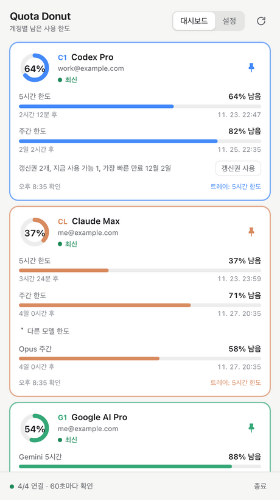
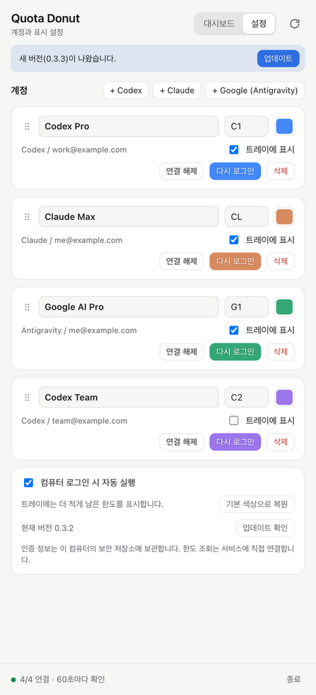
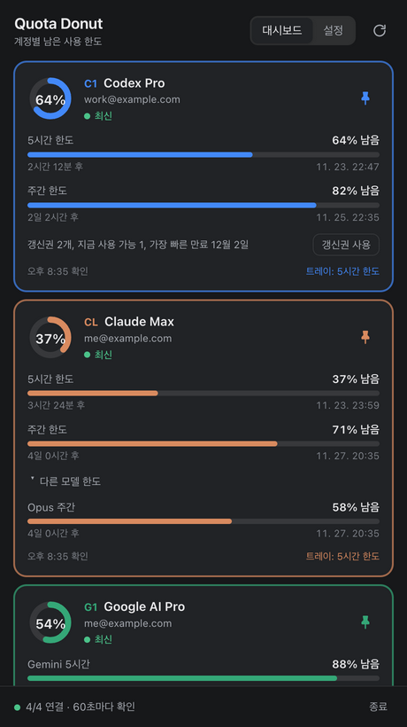
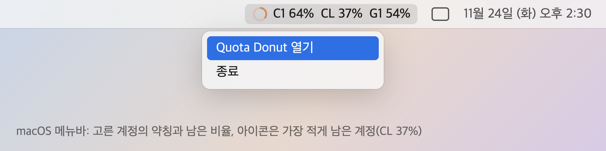
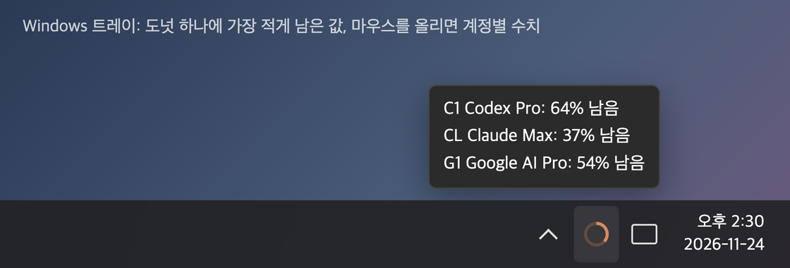

# Quota Donut

Codex, Claude, Google Antigravity(Gemini) 계정의 남은 사용 한도와 초기화 시각을 한눈에 보여 주는 macOS와 Windows용 트레이 앱이다. 여러 계정의 5시간 한도와 주간 한도를 도넛과 막대로 보여 주고, 새 버전이 나오면 앱 안에서 바로 업데이트한다.

이 저장소는 설치 파일과 업데이트 정보만 배포한다. 소스 코드는 비공개 저장소에 있다.

**[최신 버전 내려받기](https://github.com/imeru/quota-donut-releases/releases/latest)**

  
  
  

화면의 계정과 수치는 예시다.

## 특징

### 한눈에 보는 남은 한도
- 계정마다 도넛 하나로 지금 가장 적게 남은 한도를 보여 준다. 5시간 한도와 주간 한도 중 더 빠듯한 쪽을 기준으로 삼는다.
- 한도별 막대에 남은 비율, 초기화까지 남은 시간, 초기화 시각을 함께 적는다.
- Claude의 모델별 주간 한도나 Antigravity의 Claude와 GPT 모델 한도처럼 보조적인 한도는 "다른 모델 한도"에 접어 둔다. 대표 도넛 계산에는 넣지 않는다.
- 60초마다 자동으로 조회한다. 조회한 지 3분이 넘었거나 초기화 시각이 지났는데 새 값을 받지 못했으면 "이전 조회값"으로 표시해 오래된 숫자를 믿지 않게 한다.

### 여러 계정과 여러 서비스
- Codex, Claude, Google Antigravity를 지원하고, 같은 서비스의 계정도 여러 개 연결할 수 있다.
- 계정마다 이름, 5자 이내의 약칭, 색을 정할 수 있다. 설정 화면에서 ⠿ 손잡이를 끌거나, 손잡이에서 위아래 화살표 키를 눌러 순서를 바꾼다.
- Codex 계정은 한도 갱신권 개수와 가장 빠른 만료일을 보여 주고, 확인을 거쳐 바로 사용할 수 있다.

### 메뉴바와 트레이
- macOS 메뉴바에는 고른 계정의 약칭과 남은 비율을 나란히 표시한다.
- Windows 작업 표시줄 트레이는 글자를 표시할 수 없어서, 고른 계정 중 가장 적게 남은 값을 도넛 아이콘 하나로 보여 준다. 아이콘에 마우스를 올리면 계정별 수치가 나온다.
- 창을 닫아도 트레이에 남아 계속 조회한다. 컴퓨터에 로그인할 때 자동으로 실행하도록 설정할 수 있다.

  
   
  

앱이 그리는 방식을 따라 예시 수치로 만든 그림이다. 메뉴바와 작업 표시줄의 다른 아이콘은 단순화했다.

### 자동 업데이트
- 앱이 1시간마다 새 버전을 확인한다. 새 버전이 있으면 화면 위쪽에 알림이 뜨고, **업데이트**를 누르면 내려받아 서명을 검증한 뒤 설치하고 다시 시작한다.
- 설치 파일을 다시 받거나 보안 경고를 다시 거칠 필요가 없다.

### 개인정보
- 로그인은 각 서비스의 공식 로그인 페이지를 기본 브라우저로 열어 진행한다. 비밀번호를 앱에 입력하지 않는다.
- 로그인 정보(토큰)는 이 컴퓨터에만 저장한다. macOS는 Keychain에, Windows는 현재 사용자만 풀 수 있는 암호화 파일에 저장한다.
- 사용량 조회는 각 서비스 서버에 직접 요청한다. 개발자가 운영하는 서버나 분석 도구를 거치지 않는다.

## 설치

| 운영체제 | 파일 | 요구 사항 |
|---|---|---|
| macOS | `Quota.Donut_<버전>_universal.dmg` | macOS 10.15 이상, Apple Silicon과 Intel 모두 지원 |
| Windows | `Quota.Donut_<버전>_x64-setup.exe` | Windows 10 이상 64비트 |

### macOS
1. dmg를 열고 Quota Donut을 응용 프로그램 폴더로 끌어 놓는다.
2. 처음 열면 "Apple은 'Quota Donut'에 악성 코드가 없음을 확인할 수 없습니다" 같은 경고가 뜬다. Apple 개발자 서명과 공증을 받지 않은 앱이라서 나오는 경고다. **완료**를 누른다.
3. 시스템 설정 > 개인정보 보호 및 보안으로 가서 아래쪽의 **그래도 열기**를 누르고 Mac 비밀번호를 입력한다. 처음 한 번만 하면 된다.
4. 설정 화면에서 서비스를 골라 계정을 추가하고 **로그인**을 누른다. 브라우저에서 로그인을 마치면 앱에 자동으로 반영된다.
5. 로그인 정보를 Keychain에 저장할 때 허용 여부를 묻는다. **항상 허용**을 누른다.

### Windows
1. 설치 프로그램을 실행한다.
2. "Windows의 PC 보호" 창이 뜨면 **추가 정보 > 실행**을 누른다. 코드 서명을 받지 않은 설치 프로그램이라서 나오는 경고다.
3. 설치가 끝나면 작업 표시줄 트레이에 도넛 아이콘이 생긴다. 아이콘을 눌러 창을 열고 설정 화면에서 계정을 연결한다.

> Windows 버전은 아직 실제 PC에서 충분히 시험하지 못했다. 문제가 있으면 알려 주기 바란다.

## 자주 묻는 질문

**업데이트한 뒤 Keychain 허용 창이 다시 떠요.**
Apple 개발자 서명이 없는 앱은 macOS가 버전마다 다른 앱으로 기록한다. 그래서 업데이트할 때마다 한 번 묻는다. **항상 허용**을 한 번 누르면 다음 업데이트 전까지 다시 묻지 않는다.

**앱의 숫자가 공식 사용량 화면과 조금 달라요.**
앱은 60초마다 조회하고, 서비스가 알려 주는 값을 그대로 보여 준다. 방금 사용한 양이 아직 반영되지 않았을 수 있다. 오른쪽 위 새로고침 버튼을 누르면 바로 다시 조회한다.

**"이전 조회값"이라고 나와요.**
마지막 조회가 3분보다 오래됐거나 조회에 실패했다는 뜻이다. 인터넷 연결을 확인하고, 계속되면 설정에서 해당 계정을 **다시 로그인**한다.

**완전히 지우려면?**
- macOS: 응용 프로그램 폴더에서 앱을 지운다. 설정은 `~/Library/Application Support/dev.quotadonut.desktop`에, 로그인 정보는 Keychain 접근의 `QuotaDonut.crossplatform.oauth` 항목에 있다.
- Windows: 설정 > 앱에서 Quota Donut을 제거한다. 설정은 `%APPDATA%\dev.quotadonut.desktop`에, 로그인 정보는 `%LOCALAPPDATA%\dev.quotadonut.desktop`에 있다.

## 알아 둘 점

- 각 서비스가 공개하지 않은 사용량 조회 방식을 쓰고, 각 서비스의 공식 앱이 쓰는 로그인 설정을 빌려 쓴다. 서비스 쪽 변경이나 정책에 따라 로그인이나 조회가 예고 없이 멈출 수 있다. 각 서비스의 이용 약관은 직접 확인하고 사용한다.
- 개인이 만든 앱이며 OpenAI, Anthropic, Google과 관계가 없다.
